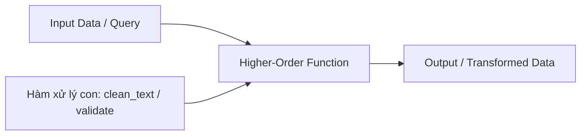

# Chuyên đề: Higher-Order Functions (HOF) trong Python & AI Engineering

> **Nội dung:** Tìm hiểu bản chất của Higher-Order Functions (Hàm bậc cao), các hàm tích hợp sẵn (`map`, `filter`, `reduce`, `sorted`), lambda, và cách ứng dụng HOF để xây dựng pipeline xử lý dữ liệu RAG, router điều phối AI Agent.

---

## 1. Higher-Order Function (Hàm bậc cao) là gì?

Trong Python, **hàm là First-Class Citizen (công dân hạng nhất)**, nghĩa là hàm được đối xử bình đẳng như mọi kiểu dữ liệu khác (`int`, `str`, `list`):
- Có thể gán hàm cho biến.
- Có thể lưu trữ hàm trong `list`, `dict`.
- Có thể truyền hàm làm tham số cho hàm khác.
- Có thể trả về một hàm từ trong một hàm khác.

> [!IMPORTANT]
> **Định nghĩa:** Một hàm được gọi là **Higher-Order Function (HOF)** nếu nó thỏa mãn ít nhất một trong hai điều kiện:
> 1. Nhận một hoặc nhiều hàm khác làm tham số đầu vào.
> 2. Trả về một hàm khác làm kết quả đầu ra.



---

## 2. Các Higher-Order Functions tích hợp sẵn (Built-in HOFs)

### 2.1. `map(function, iterable)` – Ánh xạ dữ liệu hàng loạt
Áp dụng một hàm lên từng phần tử của một danh sách (iterable) mà không cần viết vòng lặp `for`.

```python
# Ứng dụng: Chuẩn hóa text input trước khi đưa vào mô hình Embedding
texts = ["  Hà Nội mùa thu ", "ĐÀ NẴNG BIỂN XANH  ", "  sài gòn Chợ Bến Thành"]

def clean_and_normalize(text: str) -> str:
    return text.strip().lower()

# map trả về một generator (tiết kiệm RAM với tập dữ liệu lớn)
cleaned_texts = list(map(clean_and_normalize, texts))
print(cleaned_texts)
# Output: ['hà nội mùa thu', 'đà nẵng biển xanh', 'sài gòn chợ bến thành']
```

---

### 2.2. `filter(function, iterable)` – Lọc dữ liệu theo điều kiện
Nhận vào một hàm trả về `True` hoặc `False`. Chỉ giữ lại các phần tử thỏa mãn điều kiện.

```python
# Ứng dụng: Lọc bỏ các chunk văn bản rác hoặc quá ngắn trong RAG Ingestion Pipeline
chunks = [
    "Machine Learning is a subset of AI.",
    "ok",
    "",
    "Retrieval-Augmented Generation combines search and LLM generation.",
    "n/a"
]

def is_valid_chunk(chunk: str) -> bool:
    cleaned = chunk.strip()
    # Loại bỏ chunk rỗng hoặc ngắn hơn 10 ký tự
    return len(cleaned) >= 10 and cleaned.lower() not in {"ok", "n/a"}

valid_chunks = list(filter(is_valid_chunk, chunks))
print(valid_chunks)
# Output: ['Machine Learning is a subset of AI.', 'Retrieval-Augmented Generation combines search and LLM generation.']
```

---

### 2.3. `functools.reduce(function, iterable)` – Tích lũy giá trị
Duyệt qua danh sách và áp dụng phép tính liên tiếp giữa 2 phần tử kề nhau để thu về **1 giá trị duy nhất**.

```python
from functools import reduce

# Ứng dụng: Tính tổng số token tiêu thụ qua nhiều bước gọi Agent (Agent Step Accumulation)
step_tokens = [150, 420, 85, 310]  # Số token qua 4 bước reasoning

total_tokens = reduce(lambda acc, current: acc + current, step_tokens, 0)
print(f"Tổng token tiêu hao: {total_tokens}")  # Output: 965
```

---

### 2.4. `sorted(iterable, key=function)` – Sắp xếp tùy biến theo hàm
Tham số `key` trong `sorted()` nhận vào một hàm để xác định tiêu chí so sánh.

```python
# Ứng dụng: Sắp xếp kết quả tìm kiếm ngữ nghĩa theo điểm Similarity Score giảm dần
search_results = [
    {"doc_id": "doc_1", "score": 0.78, "text": "Python concurrency"},
    {"doc_id": "doc_2", "score": 0.94, "text": "LangGraph multi-agent"},
    {"doc_id": "doc_3", "score": 0.86, "text": "Pydantic validation"}
]

# Sắp xếp từ điểm cao nhất đến thấp nhất
top_results = sorted(search_results, key=lambda doc: doc["score"], reverse=True)
print(top_results[0])
# Output: {'doc_id': 'doc_2', 'score': 0.94, 'text': 'LangGraph multi-agent'}
```

---

## 3. Lambda Functions (Hàm ẩn danh) kết hợp HOF

**Lambda** là hàm nhỏ, không tên, chỉ gồm 1 biểu thức duy nhất:
```python
# Cú pháp: lambda arguments: expression
double = lambda x: x * 2
print(double(5))  # 10
```

> [!TIP]
> **Quy tắc vàng khi dùng Lambda:**  
> Chỉ dùng Lambda cho các thao tác cực kỳ ngắn gọn (ví dụ làm `key` cho `sorted` hoặc lọc nhanh trong `filter`). Nếu logic có từ 2 dòng trở lên hoặc cần xử lý ngoại lệ, **hãy dùng hàm `def` có docstring đầy đủ**.

---

## 4. Tự viết Custom Higher-Order Functions trong AI Engineering

### 4.1. Pattern 1: Function Pipeline (Chuỗi biến đổi dữ liệu RAG)
Xây dựng một HOF nhận vào danh sách các hàm xử lý văn bản và tự động chạy dữ liệu qua từng hàm theo thứ tự (tương tự toán tử pipe `|`):

```python
from typing import Callable

def compose_pipeline(*functions: Callable[[str], str]) -> Callable[[str], str]:
    """Kết hợp nhiều hàm xử lý văn bản thành một pipeline duy nhất."""
    def pipeline(input_text: str) -> str:
        data = input_text
        for func in functions:
            data = func(data)
        return data
    return pipeline

# Định nghĩa các bước làm sạch văn bản
def strip_whitespace(s: str) -> str: return s.strip()
def remove_special_chars(s: str) -> str: return "".join(ch for ch in s if ch.isalnum() or ch.isspace())
def to_lower(s: str) -> str: return s.lower()

# Tạo pipeline làm sạch
clean_pipeline = compose_pipeline(strip_whitespace, remove_special_chars, to_lower)

raw_prompt = "   ### Xin chào AI! Hãy phân tích báo cáo tài chính 2026???   \n"
print(clean_pipeline(raw_prompt))
# Output: 'xin chào ai hãy phân tích báo cáo tài chính 2026'
```

---

### 4.2. Pattern 2: Agent Intent Router (Bộ điều phối intent)
Sử dụng HOF để ánh xạ câu hỏi của người dùng vào đúng hàm xử lý (Intent Dispatcher):

```python
from typing import Callable

def create_agent_router(routes: dict[str, Callable[[str], str]]):
    """Higher-Order Function trả về một router điều phối task cho Agent."""
    def route_query(intent: str, query: str) -> str:
        handler = routes.get(intent)
        if not handler:
            return f"❌ Xin lỗi, hệ thống chưa hỗ trợ intent '{intent}'"
        return handler(query)
    return route_query

# Các hàm xử lý chuyên biệt
def handle_refund(q: str) -> str: return f"[Bộ phận Hoàn tiền] Đang xử lý yêu cầu: '{q}'"
def handle_tech_support(q: str) -> str: return f"[Bộ phận Kỹ thuật] Đang phân tích lỗi: '{q}'"

# Thiết lập bảng định tuyến
dispatcher = create_agent_router({
    "refund": handle_refund,
    "support": handle_tech_support
})

# Giả lập Agent phân loại intent và gọi hàm điều phối:
print(dispatcher("refund", "Tôi muốn trả lại đơn hàng 12345"))
# Output: [Bộ phận Hoàn tiền] Đang xử lý yêu cầu: 'Tôi muốn trả lại đơn hàng 12345'
```

---

## 5. Tổng kết

| Khái niệm | Ý nghĩa cốt lõi | Ứng dụng thực tế |
| :--- | :--- | :--- |
| **First-Class Function** | Hàm là đối tượng, gán biến được, truyền tham số được | Đăng ký tool, tạo plugin, middleware |
| **`map` / `filter`** | Ánh xạ và chọn lọc dữ liệu qua hàm | Tiền xử lý văn bản (Text normalization, Chunk filtering) |
| **`sorted(..., key=fn)`**| Sắp xếp dựa trên thuộc tính trích xuất từ hàm | Reranking kết quả tìm kiếm ngữ nghĩa, Top-K retrieval |
| **Function Factory** | Hàm sinh ra hàm khác (HOF trả về hàm) | Agent Router, Custom Prompt Builders, Decorators |
