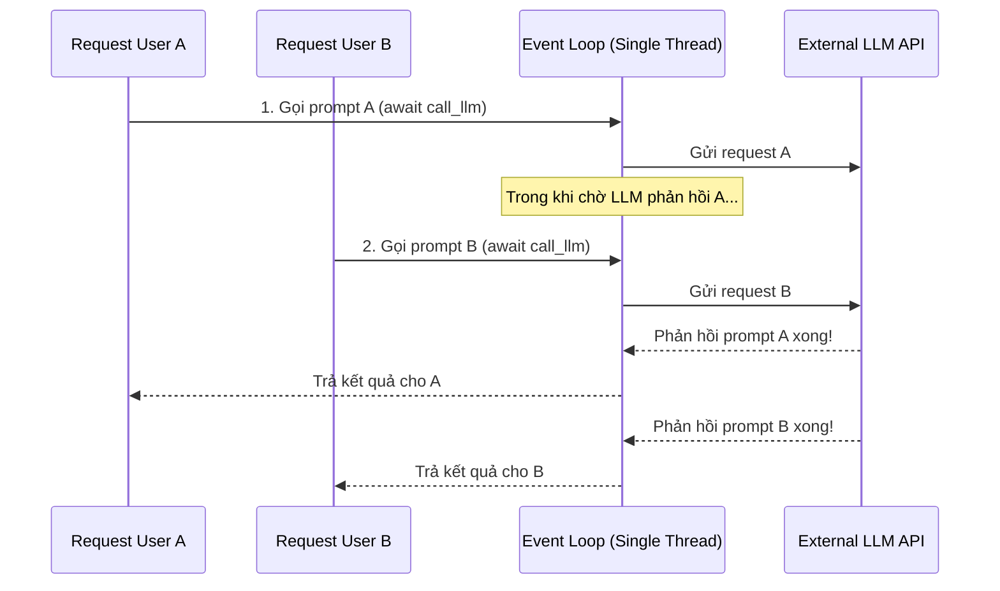

# Chuyên đề: Python Event Loop & Asynchronous Programming

> **Cốt lõi cho AI & Backend Systems:** Làm chủ cơ chế bất đồng bộ (`asyncio`, `httpx`), Structured Concurrency, Semaphore giới hạn tốc độ và Async Generator để streaming token từ LLM.

---

## Mục lục
1. [Tại sao Async Programming là bắt buộc trong AI Engineering?](#1-tại-sao-async-programming-là-bắt-buộc-trong-ai-engineering)
2. [Bản chất Event Loop & Cooperative Multitasking](#2-bản-chất-event-loop--cooperative-multitasking)
3. [Các khái niệm cốt lõi: Coroutine, Task, Future](#3-các-khái-niệm-cốt-lõi-coroutine-task-future)
4. [Điều phối tác vụ đồng thời: `gather`, `as_completed`, `TaskGroup`](#4-điều-phối-tác-vụ-đồng-thời-gather-as_completed-taskgroup)
5. [Kiểm soát hạn mức LLM với `asyncio.Semaphore` (Rate Limiting)](#5-kiểm-soát-hạn-mức-llm-với-asynciosemaphore-rate-limiting)
6. [Thực hành gọi HTTP bất đồng bộ với `httpx.AsyncClient`](#6-thực-hành-gọi-http-bất-đồng-bộ-với-httpxasyncclient)
7. [Streaming LLM Tokens với Async Generators (`async for`)](#7-streaming-llm-tokens-với-async-generators-async-for)
8. [Tóm tắt & Best Practices](#8-tóm-tắt--best-practices)

---

## 1. Tại sao Async Programming là bắt buộc trong AI Engineering?

Trong kiến trúc Backend truyền thống (CRUD Database), thời gian phản hồi thường chỉ từ **5ms – 50ms**.  
Nhưng trong **Agentic AI**:
- Gọi mô hình LLM (GPT-4, Gemini, Claude): Mất từ **1.000ms đến 15.000ms (1 - 15 giây)**.
- Gọi Vector Database (tìm kiếm Top-K): Mất **50ms – 200ms**.
- Agent thực thi vòng lặp ReAct (gọi 3 tools liên tiếp): Mất **5 – 30 giây**.

> ⚠️ **Nếu dùng code đồng bộ (Sync - như thư viện `requests`):**  
> Toàn bộ tiến trình (thread) của server bị treo cứng (blocked) trong suốt 10 giây chờ LLM phản hồi. Chỉ cần 10 người dùng gọi API cùng lúc, server của bạn sẽ cạn kiệt tài nguyên và sập!  
>  
> **Với Asynchronous I/O (`asyncio`):**  
> Trong 10 giây chờ LLM phản hồi, tiến trình Python tạm nhường quyền thực thi cho Event Loop để tiếp tục nhận và xử lý hàng nghìn request khác từ người dùng.



---

## 2. Bản chất Event Loop & Cooperative Multitasking

- **Event Loop** là một vòng lặp vô tận chạy trên **1 thread duy nhất**. Nhiệm vụ của nó là giám sát các tác vụ và phân phối quyền chạy khi có I/O sẵn sàng.
- **Cooperative Multitasking (Đa nhiệm cộng tác):** Các hàm không tự ý chiếm giữ CPU mãi mãi. Chúng chủ động nhường quyền thực thi cho Event Loop tại các điểm có từ khóa **`await`**.

> [!WARNING]
> **Quy tắc sống còn:**  
> Tuyệt đối **không được dùng các hàm blocking** (như `time.sleep()`, `requests.get()`, `urllib`) bên trong hàm `async def`. Nếu dùng, toàn bộ Event Loop sẽ bị dừng lại! Luôn thay bằng `await asyncio.sleep()` và `httpx.AsyncClient()`.

---

## 3. Các khái niệm cốt lõi: Coroutine, Task, Future

1. **Coroutine function (`async def`)**: Hàm bất đồng bộ. Khi gọi hàm này, code **chưa hề chạy ngay**, mà chỉ trả về một `Coroutine object`.
2. **`await`**: Dùng để kích hoạt coroutine và chờ kết quả (chỉ được dùng bên trong hàm `async def`).
3. **Task (`asyncio.create_task`)**: Bọc coroutine lại và đưa ngay vào Event Loop để chạy song song ở chế độ nền (background).

```python
import asyncio
import time

async def fetch_llm(model: str, delay: float) -> str:
    print(f"[{model}] Bắt đầu gọi API...")
    await asyncio.sleep(delay)  # Giả lập I/O chờ mạng
    print(f"[{model}] Đã nhận phản hồi!")
    return f"Kết quả từ {model}"

async def main():
    start = time.perf_counter()

    # Cách 1: Chạy tuần tự (mất 2 + 3 = 5 giây)
    # res1 = await fetch_llm("GPT-4", 2)
    # res2 = await fetch_llm("Claude", 3)

    # Cách 2: Chạy đồng thời bằng Tasks (chỉ mất max(2, 3) = 3 giây!)
    task1 = asyncio.create_task(fetch_llm("GPT-4", 2))
    task2 = asyncio.create_task(fetch_llm("Claude", 3))

    res1 = await task1
    res2 = await task2

    print(f"Hoàn thành toàn bộ trong {time.perf_counter() - start:.2f}s")
    print(f"Output: {res1} | {res2}")

# Chạy entry point
asyncio.run(main())
```

---

## 4. Điều phối tác vụ đồng thời: `gather`, `as_completed`, `TaskGroup`

### 4.1. `asyncio.gather(*tasks)` – Gom kết quả theo đúng thứ tự
Dùng khi bạn muốn bắn đi $N$ requests cùng lúc và nhận về kết quả theo đúng thứ tự đầu vào:

```python
async def run_gather_demo():
    prompts = ["Dịch sang tiếng Anh", "Tóm tắt văn bản", "Trích xuất thực thể"]
    
    # Tạo danh sách coroutines
    coroutines = [fetch_llm(f"Model-{i}", 1.5) for i in range(len(prompts))]
    
    # Chạy song song và gom kết quả
    results = await asyncio.gather(*coroutines, return_exceptions=True)
    print("Kết quả:", results)
```

---

### 4.2. `asyncio.as_completed(tasks)` – Xử lý cái nào xong trước
Dùng khi cần gửi query tới 3 model khác nhau, **cái nào trả về trước thì lập tức xử lý trước**:

```python
async def run_as_completed_demo():
    tasks = [
        fetch_llm("Model-A", 3.0),
        fetch_llm("Model-B", 1.0),
        fetch_llm("Model-C", 2.0)
    ]
    for completed_task in asyncio.as_completed(tasks):
        result = await completed_task
        print(f"-> Thu được kết quả sớm: {result}")
```

---

### 4.3. `asyncio.TaskGroup` (Python 3.11+) – Structured Concurrency
Đây là chuẩn hiện đại nhất của Python. Nếu 1 task trong nhóm bị lỗi, **tất cả các task còn lại sẽ tự động bị hủy (cancel) một cách an toàn**, không làm rò rỉ tài nguyên:

```python
async def run_taskgroup_demo():
    async with asyncio.TaskGroup() as tg:
        t1 = tg.create_task(fetch_llm("Model-1", 1.0))
        t2 = tg.create_task(fetch_llm("Model-2", 2.0))
    # Tự động await toàn bộ task khi thoát khối with
    print(t1.result(), t2.result())
```

---

## 5. Kiểm soát hạn mức LLM với `asyncio.Semaphore` (Rate Limiting)

Khi bạn cần xử lý 500 tài liệu qua LLM, nếu dùng `asyncio.gather(*500_tasks)` thì 500 requests sẽ bắn đi đồng thời $\rightarrow$ Chắc chắn bị lỗi **HTTP 429 (Too Many Requests)**.

`Semaphore` hoạt động như một "cửa soát vé": Chỉ cho phép tối đa $K$ coroutines chạy đồng thời tại một thời điểm:

```python
import asyncio

# Chỉ cho phép tối đa 3 requests gọi LLM cùng lúc
SEMAPHORE = asyncio.Semaphore(3)

async def rate_limited_embed(chunk_id: int):
    async with SEMAPHORE:
        print(f"[Đang chạy] Chunk {chunk_id}")
        await asyncio.sleep(1.0)  # Giả lập gọi API Embedding
        print(f"[Xong] Chunk {chunk_id}")
        return f"vector_{chunk_id}"

async def main():
    # 10 chunks nhưng chỉ chạy tối đa 3 chunk một lúc
    tasks = [rate_limited_embed(i) for i in range(10)]
    results = await asyncio.gather(*tasks)
    print("Đã vector hóa xong:", len(results))

asyncio.run(main())
```

---

## 6. Thực hành gọi HTTP bất đồng bộ với `httpx.AsyncClient`

Tuyệt đối không dùng `requests` trong async application. Thay vào đó dùng **`httpx`**:

```python
import httpx
import asyncio

async def fetch_github_user(username: str) -> dict:
    url = f"https://api.github.com/users/{username}"
    
    # Sử dụng context manager AsyncClient với timeout an toàn
    async with httpx.AsyncClient(timeout=10.0) as client:
        response = await client.get(url, headers={"User-Agent": "AI-Engineer-App"})
        response.raise_for_status()
        return response.json()

async def main():
    users = ["octocat", "torvalds", "psf"]
    tasks = [fetch_github_user(u) for u in users]
    
    results = await asyncio.gather(*tasks)
    for data in results:
        print(f"User: {data['login']} - Public Repos: {data['public_repos']}")

asyncio.run(main())
```

---

## 7. Streaming LLM Tokens với Async Generators (`async for`)

Để tạo trải nghiệm người dùng mượt mà giống như ChatGPT (chữ hiện dần dần), server cần stream từng token về giao diện qua WebSocket hoặc Server-Sent Events (SSE).

Trong Python, ta sử dụng **Async Generator** (`yield` bên trong `async def` và đọc bằng `async for`):

```python
import asyncio
from typing import AsyncGenerator

async def stream_gemini_tokens(prompt: str) -> AsyncGenerator[str, None]:
    """Giả lập streaming từng token từ mô hình LLM."""
    mock_tokens = [
        "Trí ", "tuệ ", "nhân ", "tạo ", "Agentic ", "Systems ", 
        "là ", "tương ", "lai ", "của ", "phần ", "mềm."
    ]
    for token in mock_tokens:
        await asyncio.sleep(0.15)  # Giả lập thời gian sinh từng token (TTFT & Inter-token latency)
        yield token

async def main():
    print("LLM đang gõ: ", end="", flush=True)
    async for chunk in stream_gemini_tokens("Giới thiệu AI Agent"):
        print(chunk, end="", flush=True)
    print("\n[Hoàn tất stream]")

asyncio.run(main())
```

---

## 8. Tóm tắt & Best Practices cho AI Engineer

| Tình huống | Giải pháp kỹ thuật chuẩn |
| :--- | :--- |
| Gọi API LLM / Database / Webhook | **Bắt buộc dùng `async/await`** với `httpx.AsyncClient` |
| Bắn nhiều prompt độc lập cùng lúc | Dùng `asyncio.gather()` hoặc `asyncio.TaskGroup` |
| Bắn hàng trăm prompt nhưng sợ bị 429 | Dùng **`asyncio.Semaphore(limit)`** để throttle |
| Stream phản hồi chữ chạy thời gian thực | Dùng **Async Generator** (`async for chunk in ...`) |
| Có đoạn code CPU-heavy (xử lý ảnh, tính toán numpy nặng) | Dùng **`asyncio.to_thread(sync_func, args)`** để tránh block Event Loop |
| Chờ API quá lâu không phản hồi | Bọc trong **`asyncio.timeout(seconds)`** (Python 3.11+) |
