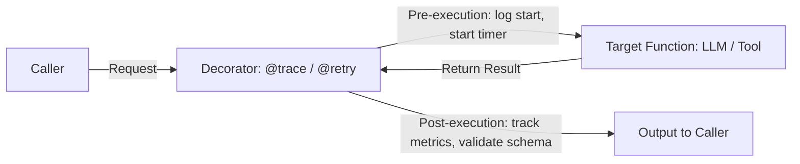
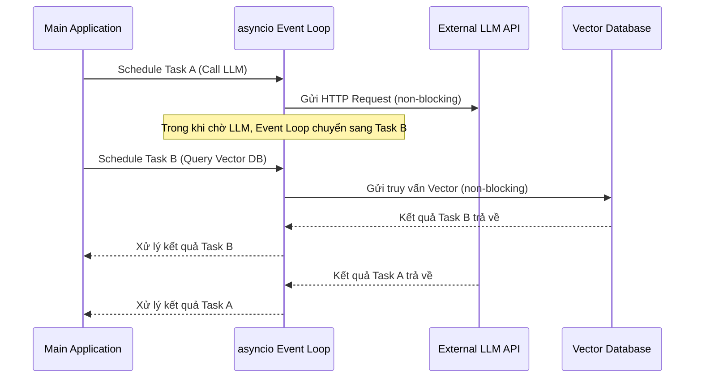

# Day 01: Python Advanced Foundations for Agentic Systems

> **Unit 1: Python Programming Advance**  
> **Target Outcome (LO1):** Nắm vững và áp dụng Python nâng cao (Package management, Metaprogramming, Pydantic v2, Asynchronous I/O với asyncio/httpx) làm nền tảng cốt lõi để xây dựng các hệ thống AI Agent và FastAPI service hiệu năng cao.

---

## Mục lục
1. [Quản lý Package & Môi trường: `venv` & `uv`](#1-quản-lý-package--môi-trường-venv--uv)
2. [Python Metaprogramming: Closure, Higher-order Function & Decorator](#2-python-metaprogramming-closure-higher-order-function--decorator)
3. [Pydantic v2 Models & Schema Validation](#3-pydantic-v2-models--schema-validation)
4. [Python Event Loop & Async Programming (`asyncio`, `httpx`)](#4-python-event-loop--async-programming-asyncio-httpx)
5. [Tóm tắt & Danh mục bài thực hành (Labs & Deliverables)](#5-tóm-tắt--danh-mục-bài-thực-hành-labs--deliverables)

---

## 1. Quản lý Package & Môi trường: `venv` & `uv`

### 1.1. Tại sao Quản lý Môi trường là bắt buộc trong AI Engineering?
- Các thư viện AI/LLM (`langchain`, `pydantic`, `torch`, `transformers`, `fastapi`, `openai`) có tần suất cập nhật rất nhanh và cây phụ thuộc (dependency tree) phức tạp.
- Tránh xung đột phiên bản (dependency hell) giữa các project khác nhau trên cùng một máy phát triển.

### 1.2. `venv` truyền thống
- Thư viện tích hợp sẵn của Python từ bản 3.3+.
- 📖 **Tài liệu hướng dẫn chi tiết từng bước:** [01-python-venv.md](file:///d:/AIE-Reskill/day-01/01-python-venv.md)
```bash
# Tạo virtual environment
python -m venv .venv

# Kích hoạt (Windows PowerShell)
.venv\Scripts\Activate.ps1

# Kích hoạt (Linux/macOS)
source .venv/bin/activate
```
- **Hạn chế:** `pip` giải quyết dependency và cài đặt tương đối chậm, thiếu tính năng lock file tích hợp hiện đại sẵn có như Cargo (Rust) hay npm (Node.js).

### 1.3. `uv` – Chuẩn công nghệ hiện đại (Astral)
`uv` là công cụ quản lý package và project Python thế hệ mới được viết bằng **Rust**, nhanh hơn `pip` từ 10 đến 100 lần. `uv` thay thế toàn diện cả `pip`, `pip-tools`, `poetry`, `virtualenv`.
- 📖 **Tài liệu hướng dẫn chi tiết từng bước & Cheat Sheet:** [02-python-uv.md](file:///d:/AIE-Reskill/day-01/02-python-uv.md)

#### Lệnh cơ bản với `uv`:
```bash
# Khởi tạo project mới (tạo pyproject.toml)
uv init

# Tạo virtual environment tự động
uv venv

# Thêm dependencies (tự động phân giải và ghi vào pyproject.toml + uv.lock)
uv add fastapi pydantic httpx pytest

# Thêm dev dependencies
uv add --dev ruff mypy

# Đồng bộ môi trường chính xác theo lock file
uv sync

# Chạy script mà không cần kích hoạt venv thủ công
uv run python main.py
```

---

## 2. Python Metaprogramming: Closure, Higher-order Function & Decorator

- 📖 **Tài liệu tham khảo chuyên sâu:**
  - [03-python-decorator.md](file:///D:/Study%20&%20Learning/AIE-Reskill/day-01/03-python-decorator.md) (Best practices, Context Managers, Closures, Decorators & AI Tool Calling)
  - [04-python-higher-order-functions.md](file:///D:/Study%20&%20Learning/AIE-Reskill/day-01/04-python-higher-order-functions.md) (Higher-Order Functions: map, filter, reduce, custom pipelines & Agent Router)

Trong các framework Agentic (LangGraph, Agno, CrewAI, Autogen), metaprogramming được ứng dụng liên tục để:
- Đăng ký công cụ (Tool Registry qua `@tool`).
- Đo lường độ trễ (latency tracking), token counting, retry khi gọi LLM APIs.
- Caching và xác thực quyền thực thi của Agent.



### 2.1. First-class Citizens & Higher-Order Functions (HOF)
Trong Python, hàm là đối tượng hạng nhất (first-class object):
- Có thể gán hàm cho biến.
- Có thể truyền hàm làm tham số cho hàm khác.
- Có thể trả về một hàm từ trong một hàm khác (Higher-Order Function).

```python
from typing import Callable, Any

def apply_resilience_policy(func: Callable[..., Any], fallback: Callable[..., Any]) -> Callable[..., Any]:
    def wrapper(*args, **kwargs):
        try:
            return func(*args, **kwargs)
        except Exception:
            return fallback(*args, **kwargs)
    return wrapper
```

### 2.2. Closures & Scoping
Closure là một hàm ghi nhớ các giá trị trong phạm vi bao bọc nó (lexical scope) ngay cả khi hàm bao bọc đã thực thi xong.

```python
def make_rate_limiter(max_calls_per_minute: int):
    call_timestamps: list[float] = []  # Nằm trong scope đóng của closure
    
    def check_limit(current_time: float) -> bool:
        nonlocal call_timestamps
        # Lọc các lần gọi trong vòng 60s
        call_timestamps = [t for t in call_timestamps if current_time - t < 60]
        if len(call_timestamps) < max_calls_per_minute:
            call_timestamps.append(current_time)
            return True
        return False

    return check_limit
```

### 2.3. Decorators và `functools.wraps`
Decorator bản chất là một HOF nhận vào một hàm và trả về một hàm mới (đã bổ sung logic trước/sau khi gọi).

#### Pattern chuẩn: Decorator có tham số (Parametric Decorator)
```python
import functools
import time
import logging

logging.basicConfig(level=logging.INFO)
logger = logging.getLogger("agent_metrics")

def log_execution_time(action_name: str):
    """Decorator đo thời gian chạy của Agent step hoặc LLM call."""
    def decorator(func):
        @functools.wraps(func)  # Giữ lại __name__, __doc__, type annotations gốc
        def wrapper(*args, **kwargs):
            start = time.perf_counter()
            logger.info(f"[{action_name}] Bắt đầu thực thi: {func.__name__}")
            try:
                result = func(*args, **kwargs)
                duration = time.perf_counter() - start
                logger.info(f"[{action_name}] Hoàn thành: {func.__name__} trong {duration:.4f}s")
                return result
            except Exception as e:
                logger.error(f"[{action_name}] Lỗi tại {func.__name__}: {str(e)}")
                raise
        return wrapper
    return decorator
```

---

## 3. Pydantic v2 Models & Schema Validation

Pydantic là xương sống của toàn bộ kiến trúc LLM hiện đại:
1. **OpenAI Structured Outputs / Instructor / LangChain**: LLM ép kiểu trả về chính xác theo JSON Schema do Pydantic sinh ra (`model_json_schema()`).
2. **Agent Tool Calling**: Tham số đầu vào của tool được định nghĩa bằng Pydantic model để LLM sinh arguments đúng chuẩn.
3. **Data Ingestion**: Chuẩn hóa dữ liệu đầu vào cho RAG pipelines.

### 3.1. Cấu trúc BaseModel & Field
```python
from pydantic import BaseModel, Field
from typing import Literal
from datetime import datetime

class ToolCallRequest(BaseModel):
    tool_name: str = Field(..., description="Tên định danh của công cụ cần gọi")
    action_type: Literal["read", "write"] = Field(..., description="Phân loại hành động an toàn hoặc rủi ro")
    parameters: dict[str, str | int | float | bool] = Field(default_factory=dict, description="Tham số truyền vào tool")
    timeout_seconds: float = Field(default=30.0, ge=1.0, le=300.0, description="Timeout tối đa cho tool")
```

### 3.2. Field Validators & Model Validators (Pydantic v2 syntax)
- `@field_validator`: Kiểm tra và chuẩn hóa từng trường đơn lẻ.
- `@model_validator(mode='after' | 'before')`: Kiểm tra quan hệ chéo giữa nhiều trường.

```python
from pydantic import BaseModel, Field, field_validator, model_validator

class AgentMessage(BaseModel):
    role: str = Field(..., description="Role của tin nhắn: system, user, assistant, tool")
    content: str = Field(..., min_length=1, description="Nội dung tin nhắn")
    tool_call_id: str | None = Field(default=None)

    @field_validator("role")
    @classmethod
    def validate_role(cls, value: str) -> str:
        allowed = {"system", "user", "assistant", "tool"}
        if value.lower() not in allowed:
            raise ValueError(f"Role không hợp lệ: {value}. Chỉ chấp nhận: {allowed}")
        return value.lower()

    @model_validator(mode="after")
    def check_tool_call_consistency(self):
        if self.role == "tool" and not self.tool_call_id:
            raise ValueError("Tin nhắn có role 'tool' bắt buộc phải có 'tool_call_id'")
        return self
```

### 3.3. Xuất JSON Schema cho LLM
```python
# Trích xuất JSON schema để đưa vào LLM tool specification
schema = ToolCallRequest.model_json_schema()
```

---

## 4. Python Event Loop & Async Programming (`asyncio`, `httpx`)

- 📖 **Tài liệu tham khảo chuyên sâu & thực hành:** [05-python-event-loop-async.md](file:///D:/Study%20&%20Learning/AIE-Reskill/day-01/05-python-event-loop-async.md) (Event Loop, TaskGroup, Semaphore throttling, httpx, Streaming tokens)

### 4.1. Kiến trúc Concurrency trong Python: I/O-bound vs CPU-bound
Trong hệ thống AI/Agent:
- **I/O-bound (90% khối lượng công việc):** Chờ phản hồi API LLM (thường mất 500ms – 10s), truy vấn Vector Database, fetch web search, gọi webhook.
- **Tại sao cần Async?** Nếu dùng code đồng bộ (sync - ví dụ thư viện `requests`), thread sẽ bị block hoàn toàn trong lúc chờ LLM trả về, server không thể phục vụ các request khác. Với `asyncio`, một single thread có thể xử lý hàng ngàn I/O requests đồng thời thông qua Event Loop.



### 4.2. Khái niệm cốt lõi của `asyncio`
1. **Coroutine (`async def`)**: Hàm có thể tạm dừng (suspend) và tiếp tục (resume) tại các điểm `await`.
2. **Task**: Một Coroutine được bọc vào Event Loop để chạy đồng thời (concurrent execution).
3. **Future**: Đối tượng đại diện cho một kết quả chưa hoàn thành của một tác vụ bất đồng bộ.

### 4.3. Các Pattern điều phối Async quan trọng

#### A. Gọi đồng thời với `asyncio.gather`
```python
import asyncio
import httpx

async def fetch_chunk(client: httpx.AsyncClient, url: str) -> dict:
    response = await client.get(url, timeout=10.0)
    response.raise_for_status()
    return response.json()

async def fetch_all(urls: list[str]) -> list[dict]:
    async with httpx.AsyncClient() as client:
        tasks = [fetch_chunk(client, url) for url in urls]
        results = await asyncio.gather(*tasks, return_exceptions=True)
        return results
```

#### B. Kiểm soát Concurrency bằng `asyncio.Semaphore` (Rate Limiting)
Khi gọi đồng thời 100 truy vấn tới LLM API, nếu không giới hạn sẽ bị dính `429 Too Many Requests`.
```python
sem = asyncio.Semaphore(5)  # Tối đa 5 request đồng thời

async def call_llm_rate_limited(prompt: str) -> str:
    async with sem:
        # Chỉ có tối đa 5 coroutine được vào block này cùng lúc
        await asyncio.sleep(1) # Giả lập I/O call
        return f"Result for: {prompt}"
```

#### C. Quản lý Task hiện đại với `asyncio.TaskGroup` (Python 3.11+)
Cung cấp **Structured Concurrency**: Nếu 1 task con bị crash, toàn bộ các task còn lại trong nhóm sẽ tự động được cancel an toàn.
```python
async def run_pipeline():
    async with asyncio.TaskGroup() as tg:
        task1 = tg.create_task(step_one())
        task2 = tg.create_task(step_two())
    # Cả hai task đều đã hoàn thành khi ra khỏi block with
    print(task1.result(), task2.result())
```

#### D. Async Generator (Streaming LLM Tokens)
Dùng để stream kết quả token từ LLM về giao diện người dùng theo thời gian thực:
```python
from typing import AsyncGenerator

async def stream_agent_response(prompt: str) -> AsyncGenerator[str, None]:
    for token in ["Hello", " I", " am", " an", " Agent."]:
        await asyncio.sleep(0.1)  # Giả lập token stream từ API
        yield token
```

---

## 5. Tóm tắt & Danh mục bài thực hành (Labs & Deliverables)

Dựa trên yêu cầu của **Day 1**:

| STT | File Lab / Deliverable | Mục tiêu |
| :---: | :--- | :--- |
| 1 | `src/01_metaprogramming.py` | Cài đặt Decorator `@track_agent_call` và `@retry_with_backoff` với `functools.wraps`. |
| 2 | `src/02_pydantic_schemas.py` | Xây dựng Data Models cho Agent: `AgentTool`, `AgentMessage`, `StructuredPlan` kèm validation logic & xuất JSON Schema. |
| 3 | `src/03_async_pipeline.py` | Xây dựng pipeline gọi I/O bất đồng bộ kết hợp `httpx.AsyncClient`, `asyncio.Semaphore` và `asyncio.TaskGroup`. |
| 4 | `deliverables/day_01_summary.md` | Bản tóm tắt 1 trang (Key learning summary) và sơ đồ luồng thực thi Async (Async execution flow). |
