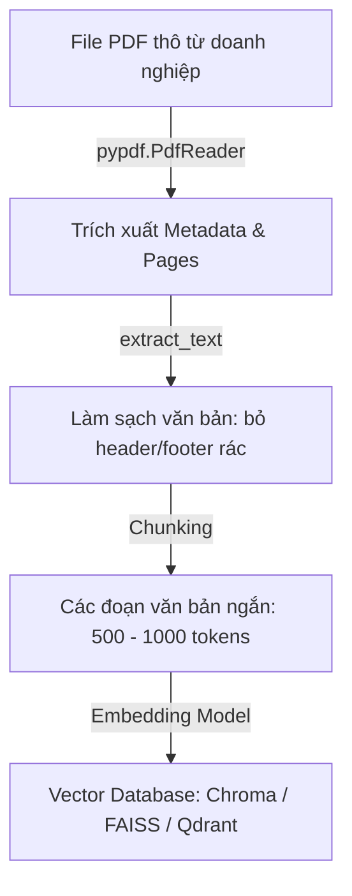

# Chuyên đề: Xử lý & Bóc tách File PDF với `pypdf` (Document Parsing)

> **Mục tiêu cho AI Engineer:**  
> Trong các hệ thống **RAG (Retrieval-Augmented Generation)**, PDF là định dạng tài liệu phổ biến nhất từ doanh nghiệp (hợp đồng, báo cáo tài chính, tài liệu kỹ thuật). Việc bóc tách chính xác text, metadata (tiêu đề, tác giả) và xử lý phân trang (merge, split) là bước tiền đề sống còn trước khi đưa vào Embedding Model và Vector Database.

---

## 1. Lược sử & Thư viện PDF chuẩn hiện đại trong Python

- **2005 – 2010:** Gói gốc `pyPdf` ra đời, hỗ trợ Python 2.
- **2011 – 2016:** `PyPDF2` (sau đó có các nhánh PyPDF3, PyPDF4) tiếp quản và hỗ trợ Python 3.
- **Từ 2022 đến nay:** Toàn bộ các nhánh phân mảnh (`PyPDF2`, `PyPDF3`, `PyPDF4`) đã chính thức **hợp nhất trở lại thành một gói duy nhất tên là `pypdf`**.
- Gói `pypdf` hiện đại (v3.x, v4.x, v5.x) tối ưu tốc độ vượt trội, loại bỏ cú pháp lạc hậu (`camelCase`) và chuyển hoàn toàn sang chuẩn Pythonic (`snake_case`).

> [!TIP]
> **Quy chuẩn cài đặt hiện nay:**  
> Thay vì cài `PyPDF2` cũ, hãy dùng `pypdf` (thư viện không phụ thuộc bên thứ 3, cài đặt trong vài giây):
> ```powershell
> # Sử dụng uv (Khuyên dùng)
> uv add pypdf
> 
> # Hoặc pip truyền thống
> pip install pypdf
> ```

---

## 2. Bóc tách Metadata & Số trang của PDF

Trích xuất thông tin tác giả, tiêu đề, ngày tạo để gắn vào trường `metadata` trong Vector Store (giúp lọc tài liệu theo tác giả/thời gian khi tìm kiếm RAG).

```python
from pypdf import PdfReader

def extract_pdf_info(pdf_path: str):
    reader = PdfReader(pdf_path)
    
    # Số trang
    total_pages = len(reader.pages)
    
    # Metadata tài liệu
    meta = reader.metadata
    
    print(f"📄 Thông tin tài liệu: {pdf_path}")
    print(f"- Số trang: {total_pages}")
    if meta:
        print(f"- Tiêu đề: {meta.title}")
        print(f"- Tác giả: {meta.author}")
        print(f"- Người tạo (Creator): {meta.creator}")
        print(f"- Chủ đề: {meta.subject}")
    
    return meta, total_pages

# Ví dụ chạy:
# extract_pdf_info("sample.pdf")
```

---

## 3. Bóc tách Nội dung Text (Trọng tâm RAG Ingestion)

Mỗi trang trong PDF là một đối tượng `PageObject`. Ta duyệt qua từng trang và gọi `.extract_text()`:

```python
from pypdf import PdfReader

def extract_text_from_pdf(pdf_path: str) -> list[dict]:
    """Bóc tách text từng trang kèm metadata số trang để phục vụ RAG chunking."""
    reader = PdfReader(pdf_path)
    documents = []
    
    for page_idx, page in enumerate(reader.pages):
        text = page.extract_text() or ""
        text = text.strip()
        
        if text:  # Bỏ qua các trang trắng
            documents.append({
                "page": page_idx + 1,
                "text": text,
                "char_count": len(text)
            })
            
    print(f"Đã trích xuất {len(documents)} trang có nội dung từ {pdf_path}")
    return documents

# Demo bóc tách:
# docs = extract_text_from_pdf("sample.pdf")
# print("Trang 1:", docs[0]["text"][:200])
```

---

## 4. Thao tác Trang: Xoay trang (Rotate Pages)

Khi scan tài liệu, nhiều trang có thể bị đặt ngang (landscape) hoặc ngược đầu. Ta có thể xoay lại theo góc bội số của 90 độ (`90`, `180`, `270`):

```python
from pypdf import PdfReader, PdfWriter

def rotate_pdf_pages(input_path: str, output_path: str):
    reader = PdfReader(input_path)
    writer = PdfWriter()

    for idx, page in enumerate(reader.pages):
        if idx == 0:
            # Xoay trang đầu 90 độ theo chiều kim đồng hồ
            page.rotate(90)
        elif idx == 1:
            # Xoay trang hai 270 độ (hoặc -90)
            page.rotate(270)
            
        writer.add_page(page)

    with open(output_path, "wb") as f:
        writer.write(f)
    print(f"✅ Đã lưu file đã xoay trang tại: {output_path}")
```

---

## 5. Ghép nối nhiều file PDF (Merge PDFs)

Dùng class tiện ích **`PdfMerger`** để nối các file hoặc chỉ định chèn trang cụ thể:

```python
from pypdf import PdfMerger

def merge_multiple_pdfs(pdf_list: list[str], output_path: str):
    """Nối danh sách các file PDF thành 1 file hoàn chỉnh."""
    merger = PdfMerger()

    for pdf in pdf_list:
        print(f"Đang ghép: {pdf}")
        merger.append(pdf)

    with open(output_path, "wb") as f:
        merger.write(f)
        
    merger.close()
    print(f"✅ Đã ghép thành công: {output_path}")

# merge_multiple_pdfs(["cover.pdf", "chapter1.pdf", "chapter2.pdf"], "complete_book.pdf")
```

---

## 6. Cắt nhỏ file PDF (Split PDFs)

Khi tài liệu PDF quá dài (hàng trăm trang), việc chia nhỏ thành từng file đơn lẻ hoặc theo chương giúp xử lý song song nhanh hơn:

```python
from pypdf import PdfReader, PdfWriter

def split_pdf_pages(input_path: str, output_prefix: str):
    reader = PdfReader(input_path)
    
    for idx, page in enumerate(reader.pages):
        writer = PdfWriter()
        writer.add_page(page)
        
        output_filename = f"{output_prefix}_page_{idx + 1}.pdf"
        with open(output_filename, "wb") as f:
            writer.write(f)
            
    print(f"✅ Đã tách {len(reader.pages)} trang thành các file riêng biệt.")

# split_pdf_pages("report.pdf", "output/report")
```

---

## 7. Đóng dấu Watermark & Bảo vệ bản quyền

Đè một trang PDF chứa hình mờ (Watermark) lên toàn bộ các trang của tài liệu gốc:

```python
from pypdf import PdfReader, PdfWriter

def apply_watermark(input_pdf: str, watermark_pdf: str, output_pdf: str):
    reader = PdfReader(input_pdf)
    watermark = PdfReader(watermark_pdf).pages[0]
    writer = PdfWriter()

    for page in reader.pages:
        # Hợp nhất trang watermark đè lên trang hiện tại
        page.merge_page(watermark)
        writer.add_page(page)

    with open(output_pdf, "wb") as f:
        writer.write(f)
    print(f"✅ Đã đóng dấu watermark thành công: {output_pdf}")
```

---

## 8. Mã hóa & Đặt mật khẩu PDF (Encryption)

Đặt mật khẩu bảo vệ file (chỉ người có mật khẩu mới mở đọc được):

```python
from pypdf import PdfReader, PdfWriter

def encrypt_pdf(input_path: str, output_path: str, password: str):
    reader = PdfReader(input_path)
    writer = PdfWriter()

    # Thêm toàn bộ các trang vào writer
    for page in reader.pages:
        writer.add_page(page)

    # Mã hóa bằng thuật toán chuẩn AES-128
    writer.encrypt(user_password=password, algorithm="AES-128")

    with open(output_path, "wb") as f:
        writer.write(f)
    print(f"🔒 Đã mã hóa file với mật khẩu bảo vệ: {output_path}")

# Mở file đã mã hóa:
def read_encrypted_pdf(encrypted_path: str, password: str):
    reader = PdfReader(encrypted_path)
    if reader.is_encrypted:
        reader.decrypt(password)
    print("Trang đầu:", reader.pages[0].extract_text()[:100])
```

---

## 9. So sánh cú pháp Cũ (`PyPDF2`) vs Mới (`pypdf`)

Để bạn không bị bỡ ngỡ khi đọc các bài hướng dẫn hoặc codebase cũ trên mạng:

| Thao tác | Cú pháp cũ (`PyPDF2` - Lạc hậu) | Cú pháp mới (`pypdf` - Chuẩn hiện nay) |
| :--- | :--- | :--- |
| **Import** | `from PyPDF2 import PdfFileReader, PdfFileWriter` | `from pypdf import PdfReader, PdfWriter` |
| **Đọc file** | `reader = PdfFileReader("file.pdf")` | `reader = PdfReader("file.pdf")` |
| **Đếm số trang** | `reader.getNumPages()` | `len(reader.pages)` |
| **Lấy trang** | `reader.getPage(0)` | `reader.pages[0]` |
| **Xoay trang** | `page.rotateClockwise(90)` | `page.rotate(90)` |
| **Trích xuất text** | `page.extractText()` *(rất nhiều lỗi)* | `page.extract_text()` *(tối ưu, hỗ trợ Unicode tốt)* |
| **Ghép trang watermark**| `page.mergePage(watermark)` | `page.merge_page(watermark)` |
| **Thêm trang vào writer** | `writer.addPage(page)` | `writer.add_page(page)` |

---

## 10. Tóm tắt & Ứng dụng trong RAG Ingestion Pipeline



> [!NOTE]
> Khi xử lý các file PDF phức tạp chứa bảng biểu dạng lưới (tables) hoặc file scan chỉ gồm ảnh, trong thực tế ta sẽ kết hợp thêm các công cụ chuyên dụng như `pdfplumber` (cho bảng biểu) hoặc `pytesseract` / OCR model (cho PDF dạng scan hình ảnh).
